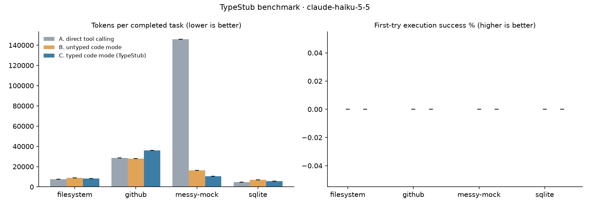

# TypeStub benchmark results: `smoke`

12 episodes (0 dropped for API errors). Values are point estimates with 95% bootstrap CIs over tasks.
Sampling: model defaults (these models do not accept `temperature`), effort medium.

## claude-haiku-5-5

| server | condition | task success | first-try success | round trips | tokens / completed task | tokens / episode | non-submitting scripts | wall s |
|---|---|---|---|---|---|---|---|---|
| filesystem | A | 100.0% [100.0, 100.0] | — | 3.00 [3.00, 3.00] | 7,711 [7,711, 7,711] | 7,711 [7,711, 7,711] | 0.00 [0.00, 0.00] | 3.01 [3.01, 3.01] |
| filesystem | B | 100.0% [100.0, 100.0] | 0.0% [0.0, 0.0] | 4.00 [4.00, 4.00] | 8,945 [8,945, 8,945] | 8,945 [8,945, 8,945] | 2.00 [2.00, 2.00] | 4.82 [4.82, 4.82] |
| filesystem | C | 100.0% [100.0, 100.0] | 0.0% [0.0, 0.0] | 3.00 [3.00, 3.00] | 8,212 [8,212, 8,212] | 8,212 [8,212, 8,212] | 2.00 [2.00, 2.00] | 3.01 [3.01, 3.01] |
| github | A | 100.0% [100.0, 100.0] | — | 3.00 [3.00, 3.00] | 28,522 [28,522, 28,522] | 28,522 [28,522, 28,522] | 0.00 [0.00, 0.00] | 8.92 [8.92, 8.92] |
| github | B | 100.0% [100.0, 100.0] | 0.0% [0.0, 0.0] | 4.00 [4.00, 4.00] | 27,769 [27,769, 27,769] | 27,769 [27,769, 27,769] | 2.00 [2.00, 2.00] | 8.99 [8.99, 8.99] |
| github | C | 100.0% [100.0, 100.0] | 0.0% [0.0, 0.0] | 3.00 [3.00, 3.00] | 35,868 [35,868, 35,868] | 35,868 [35,868, 35,868] | 2.00 [2.00, 2.00] | 8.91 [8.91, 8.91] |
| messy-mock | A | 100.0% [100.0, 100.0] | — | 5.00 [5.00, 5.00] | 146,009 [146,009, 146,009] | 146,009 [146,009, 146,009] | 0.00 [0.00, 0.00] | 47.50 [47.50, 47.50] |
| messy-mock | B | 100.0% [100.0, 100.0] | 0.0% [0.0, 0.0] | 4.00 [4.00, 4.00] | 16,430 [16,430, 16,430] | 16,430 [16,430, 16,430] | 3.00 [3.00, 3.00] | 7.48 [7.48, 7.48] |
| messy-mock | C | 100.0% [100.0, 100.0] | 0.0% [0.0, 0.0] | 2.00 [2.00, 2.00] | 10,507 [10,507, 10,507] | 10,507 [10,507, 10,507] | 1.00 [1.00, 1.00] | 2.89 [2.89, 2.89] |
| sqlite | A | 100.0% [100.0, 100.0] | — | 4.00 [4.00, 4.00] | 4,582 [4,582, 4,582] | 4,582 [4,582, 4,582] | 0.00 [0.00, 0.00] | 7.44 [7.44, 7.44] |
| sqlite | B | 100.0% [100.0, 100.0] | 0.0% [0.0, 0.0] | 4.00 [4.00, 4.00] | 7,002 [7,002, 7,002] | 7,002 [7,002, 7,002] | 3.00 [3.00, 3.00] | 4.77 [4.77, 4.77] |
| sqlite | C | 100.0% [100.0, 100.0] | 0.0% [0.0, 0.0] | 3.00 [3.00, 3.00] | 5,558 [5,558, 5,558] | 5,558 [5,558, 5,558] | 2.00 [2.00, 2.00] | 3.39 [3.39, 3.39] |
| all | A | 100.0% [100.0, 100.0] | — | 3.75 [3.00, 4.50] | 46,706 [6,146, 111,434] | 46,706 [6,146, 111,434] | 0.00 [0.00, 0.00] | 16.72 [4.49, 37.48] |
| all | B | 100.0% [100.0, 100.0] | 0.0% [0.0, 0.0] | 4.00 [4.00, 4.00] | 15,036 [7,974, 23,063] | 15,036 [7,974, 23,063] | 2.50 [2.00, 3.00] | 6.51 [4.79, 8.23] |
| all | C | 100.0% [100.0, 100.0] | 0.0% [0.0, 0.0] | 2.75 [2.25, 3.00] | 15,036 [6,795, 28,954] | 15,036 [6,795, 28,954] | 1.75 [1.25, 2.00] | 4.55 [2.95, 7.43] |

**Typed (C) vs untyped (B) code mode**

| server | tokens / completed task | first-try success | task success | round trips |
|---|---|---|---|---|
| filesystem | -8.2% [-8.2, -8.2] | 0.0% [0.0, 0.0] pts | 0.0% [0.0, 0.0] pts | -1.00 [-1.00, -1.00] |
| github | 29.2% [29.2, 29.2] | 0.0% [0.0, 0.0] pts | 0.0% [0.0, 0.0] pts | -1.00 [-1.00, -1.00] |
| messy-mock | -36.0% [-36.0, -36.0] | 0.0% [0.0, 0.0] pts | 0.0% [0.0, 0.0] pts | -2.00 [-2.00, -2.00] |
| sqlite | -20.6% [-20.6, -20.6] | 0.0% [0.0, 0.0] pts | 0.0% [0.0, 0.0] pts | -1.00 [-1.00, -1.00] |
| all | -0.0% [-31.8, 25.3] | 0.0% [0.0, 0.0] pts | 0.0% [0.0, 0.0] pts | -1.25 [-1.75, -1.00] |

**Stub overhead** (system prompt tokens, counted with the token-counting API)

| server | untyped (B) | typed (C) | typed overhead |
|---|---|---|---|
| filesystem | 1,402 | 1,908 | 506 |
| github | 4,585 | 10,145 | 5,560 |
| messy-mock | 1,585 | 4,513 | 2,928 |
| sqlite | 586 | 792 | 206 |

**v0 success criteria**

| area | metric | target | measured | met |
|---|---|---|---|---|
| Cost | tokens per completed task, C vs B | ≤ -30% | -0.0% [-31.8, 25.3] | no |
| Reliability | first-try execution success, C vs B | ≥ +20 pts | 0.0% [0.0, 0.0] | no |
| Speed | round trips per task (C) | ≤ 1.5 | 2.75 [2.25, 3.00] | no |
| Quality | task success, C vs B | no drop | 0.0% [0.0, 0.0] | yes |
| Overhead | typed stub tokens (worst server) | < 1,500 | 5,560 | no |

