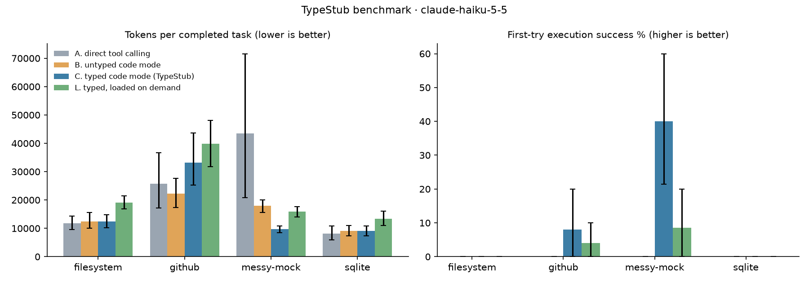
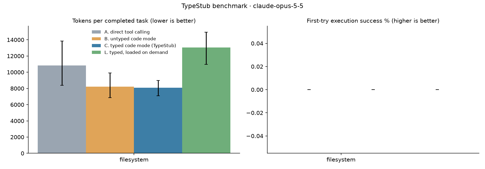

# TypeStub benchmark results: `v0`

944 episodes (656 dropped for API errors). Values are point estimates with 95% bootstrap CIs over tasks.
Billed tokens weight each episode as it is billed, in input-token equivalents: cache reads 0.1x, cache writes 1.25x, output at the output/input price ratio. Raw tokens count cache reads at full weight, which overstates the cost of a stub that sits in the cached system prompt. First fetch right: the first script ran cleanly, later scripts made no tool calls, and the answer passed (a separate submit-only turn does not count against it).
Sampling: model defaults (these models do not accept `temperature`), effort medium.

## claude-haiku-5-5

| server | condition | task success | first-try success | first fetch right | round trips | tokens / completed task | billed tokens / completed task | tokens / episode | non-submitting scripts | wall s |
|---|---|---|---|---|---|---|---|---|---|---|
| filesystem | A | 100.0% [100.0, 100.0] | — | — | 3.48 [3.17, 3.77] | 11,749 [9,528, 14,358] | 8,368 [5,286, 12,504] | 11,749 [9,530, 14,193] | 0.00 [0.00, 0.00] | 4.83 [3.67, 6.36] |
| filesystem | B | 100.0% [100.0, 100.0] | 0.0% [0.0, 0.0] | 0.0% [0.0, 0.0] | 4.25 [3.83, 4.78] | 12,473 [10,050, 15,536] | 7,749 [5,836, 9,885] | 12,473 [10,123, 15,579] | 2.75 [2.38, 3.12] | 5.35 [4.42, 6.48] |
| filesystem | C | 100.0% [100.0, 100.0] | 0.0% [0.0, 0.0] | 10.0% [0.0, 25.0] | 3.60 [3.08, 4.15] | 12,417 [10,219, 14,818] | 7,572 [6,204, 8,726] | 12,417 [10,219, 14,990] | 2.30 [1.90, 2.67] | 4.65 [3.93, 5.26] |
| filesystem | L | 100.0% [100.0, 100.0] | 0.0% [0.0, 0.0] | 0.0% [0.0, 0.0] | 4.60 [4.20, 4.95] | 19,156 [16,854, 21,482] | 9,914 [8,260, 11,730] | 19,156 [16,853, 21,440] | 2.73 [2.30, 3.20] | 6.34 [5.51, 7.04] |
| github | A | 98.0% [94.0, 100.0] | — | — | 2.48 [2.16, 2.88] | 25,753 [17,257, 36,681] | 14,955 [8,097, 23,514] | 25,238 [17,344, 34,893] | 0.00 [0.00, 0.00] | 7.46 [4.05, 11.93] |
| github | B | 100.0% [100.0, 100.0] | 0.0% [0.0, 0.0] | 30.0% [8.0, 58.0] | 3.36 [2.70, 4.08] | 22,222 [17,361, 27,574] | 10,497 [7,803, 13,299] | 22,222 [17,403, 27,550] | 2.10 [1.54, 2.74] | 10.00 [6.11, 14.49] |
| github | C | 92.0% [80.0, 100.0] | 8.0% [0.0, 20.0] | 46.0% [26.0, 66.0] | 2.60 [2.08, 3.38] | 33,146 [25,233, 43,706] | 12,811 [9,836, 16,029] | 30,494 [23,608, 39,974] | 1.44 [1.10, 1.92] | 11.40 [5.62, 18.59] |
| github | L | 100.0% [100.0, 100.0] | 4.0% [0.0, 10.0] | 28.0% [8.0, 50.0] | 4.46 [3.80, 5.14] | 39,848 [31,805, 48,064] | 15,022 [12,246, 17,582] | 39,848 [31,991, 47,571] | 1.86 [1.44, 2.32] | 16.13 [8.25, 27.07] |
| messy-mock | A | 100.0% [100.0, 100.0] | — | — | 3.20 [2.63, 3.84] | 43,492 [20,774, 71,619] | 33,259 [16,524, 55,612] | 43,492 [20,132, 70,673] | 0.00 [0.00, 0.00] | 9.63 [5.11, 16.60] |
| messy-mock | B | 100.0% [100.0, 100.0] | 0.0% [0.0, 0.0] | 0.0% [0.0, 0.0] | 4.30 [3.97, 4.63] | 17,897 [15,642, 20,080] | 11,681 [10,265, 13,012] | 17,897 [15,566, 20,047] | 2.86 [2.57, 3.13] | 7.43 [6.37, 8.46] |
| messy-mock | C | 100.0% [100.0, 100.0] | 40.0% [21.4, 60.0] | 71.4% [60.0, 82.9] | 1.79 [1.54, 2.01] | 9,732 [8,392, 10,915] | 4,957 [4,309, 5,615] | 9,732 [8,377, 10,948] | 0.79 [0.54, 1.01] | 2.80 [2.39, 3.21] |
| messy-mock | L | 100.0% [100.0, 100.0] | 8.6% [0.0, 20.0] | 52.9% [35.7, 70.0] | 3.57 [3.27, 3.90] | 15,855 [13,953, 17,725] | 8,962 [7,966, 10,068] | 15,855 [13,981, 17,656] | 1.37 [1.16, 1.59] | 5.44 [4.83, 6.07] |
| sqlite | A | 100.0% [100.0, 100.0] | — | — | 4.55 [4.25, 4.88] | 8,158 [5,934, 10,912] | 5,528 [3,831, 7,710] | 8,158 [6,055, 11,052] | 0.00 [0.00, 0.00] | 5.33 [4.60, 6.14] |
| sqlite | B | 95.0% [85.0, 100.0] | 0.0% [0.0, 0.0] | 0.0% [0.0, 0.0] | 4.25 [3.88, 4.55] | 9,128 [7,371, 11,035] | 6,524 [5,254, 7,794] | 8,672 [7,104, 10,180] | 3.27 [2.88, 3.62] | 5.77 [4.44, 7.32] |
| sqlite | C | 97.5% [92.5, 100.0] | 0.0% [0.0, 0.0] | 0.0% [0.0, 0.0] | 3.83 [3.50, 4.12] | 9,062 [7,395, 10,920] | 6,385 [5,182, 7,844] | 8,836 [7,447, 10,541] | 3.17 [2.88, 3.52] | 4.74 [4.20, 5.34] |
| sqlite | L | 100.0% [100.0, 100.0] | 0.0% [0.0, 0.0] | 0.0% [0.0, 0.0] | 4.65 [4.20, 5.12] | 13,300 [11,009, 16,069] | 7,858 [6,778, 9,155] | 13,300 [10,823, 15,989] | 3.40 [3.08, 3.77] | 5.76 [4.96, 6.63] |
| all | A | 99.5% [98.5, 100.0] | — | — | 3.35 [3.03, 3.65] | 25,641 [16,699, 37,173] | 18,174 [11,470, 26,697] | 25,513 [16,425, 36,901] | 0.00 [0.00, 0.00] | 7.27 [5.22, 10.11] |
| all | B | 99.0% [97.0, 100.0] | 0.0% [0.0, 0.0] | 7.5% [0.5, 17.0] | 4.04 [3.77, 4.31] | 16,211 [14,067, 18,489] | 9,598 [8,353, 10,820] | 16,048 [13,888, 18,294] | 2.73 [2.46, 2.96] | 7.32 [6.17, 8.66] |
| all | C | 97.5% [94.0, 100.0] | 16.0% [7.5, 25.0] | 38.5% [27.5, 50.5] | 2.76 [2.42, 3.08] | 15,672 [12,326, 19,802] | 7,632 [6,500, 8,905] | 15,280 [12,065, 19,429] | 1.73 [1.42, 2.06] | 5.71 [4.07, 7.88] |
| all | L | 100.0% [100.0, 100.0] | 4.0% [1.0, 8.0] | 25.5% [15.5, 37.0] | 4.21 [3.94, 4.49] | 22,003 [18,390, 25,897] | 10,447 [9,303, 11,698] | 22,003 [18,389, 26,216] | 2.17 [1.86, 2.48] | 8.36 [6.18, 11.55] |

**Typed (C) vs untyped (B) code mode**

| server | tokens / completed task | billed tokens / completed task | first-try success | first fetch right | task success | round trips |
|---|---|---|---|---|---|---|
| filesystem | -0.4% [-23.4, 26.1] | -2.3% [-17.7, 16.5] | 0.0% [0.0, 0.0] pts | 10.0% [0.0, 25.0] pts | 0.0% [0.0, 0.0] pts | -0.65 [-1.38, -0.03] |
| github | 49.2% [20.2, 91.9] | 22.1% [-1.7, 53.0] | 8.0% [0.0, 16.1] pts | 16.0% [-6.0, 40.0] pts | -8.0% [-20.0, 0.0] pts | -0.76 [-1.54, 0.04] |
| messy-mock | -45.6% [-52.8, -38.5] | -57.6% [-63.2, -51.0] | 40.0% [21.4, 58.6] pts | 71.4% [60.0, 82.9] pts | 0.0% [0.0, 0.0] pts | -2.51 [-2.79, -2.24] |
| sqlite | -0.7% [-12.7, 12.9] | -2.1% [-12.1, 9.7] | 0.0% [0.0, 0.0] pts | 0.0% [0.0, 0.0] pts | 2.5% [0.0, 7.5] pts | -0.42 [-0.88, 0.02] |
| all | -3.3% [-19.7, 17.0] | -20.5% [-33.3, -5.8] | 16.0% [8.0, 25.5] pts | 31.0% [19.0, 44.0] pts | -1.5% [-5.5, 1.0] pts | -1.29 [-1.66, -0.90] |

**Typed on demand (L) vs untyped (B) code mode**

| server | tokens / completed task | billed tokens / completed task | first-try success | first fetch right | task success | round trips |
|---|---|---|---|---|---|---|
| filesystem | 53.6% [20.8, 84.8] | 27.9% [8.1, 50.9] | 0.0% [0.0, 0.0] pts | 0.0% [0.0, 0.0] pts | 0.0% [0.0, 0.0] pts | 0.35 [-0.40, 0.93] |
| github | 79.3% [39.1, 143.9] | 43.1% [14.6, 88.5] | 4.0% [0.0, 10.0] pts | -2.0% [-22.0, 16.0] pts | 0.0% [0.0, 0.0] pts | 1.10 [0.38, 1.78] |
| messy-mock | -11.4% [-22.7, 1.9] | -23.3% [-34.3, -9.0] | 8.6% [0.0, 18.6] pts | 52.9% [35.7, 70.0] pts | 0.0% [0.0, 0.0] pts | -0.73 [-1.03, -0.39] |
| sqlite | 45.7% [23.6, 65.8] | 20.5% [5.2, 34.9] | 0.0% [0.0, 0.0] pts | 0.0% [0.0, 0.0] pts | 5.0% [0.0, 15.0] pts | 0.40 [0.10, 0.78] |
| all | 35.7% [15.3, 59.6] | 8.8% [-5.2, 24.3] | 4.0% [1.0, 8.5] pts | 18.0% [7.0, 29.5] pts | 1.0% [0.0, 3.0] pts | 0.17 [-0.17, 0.53] |

**Stub overhead** (system prompt tokens, counted with the token-counting API; L also pays for `types` results inside the episode)

| server | untyped (B) | typed (C) | C overhead | lazy (L) | L overhead |
|---|---|---|---|---|---|
| filesystem | 1,402 | 1,908 | 506 | 2,085 | 683 |
| github | 4,585 | 10,145 | 5,560 | 5,445 | 860 |
| messy-mock | 1,585 | 4,513 | 2,928 | 2,104 | 519 |
| sqlite | 586 | 792 | 206 | 763 | 177 |

**v0 success criteria**

| area | metric | target | measured | met |
|---|---|---|---|---|
| Cost | tokens per completed task, C vs B | ≤ -30% | -3.3% [-19.7, 17.0] | no |
| Cost (billed) | billed tokens per completed task, C vs B | ≤ -30% | -20.5% [-33.3, -5.8] | no |
| Reliability | first-try execution success, C vs B | ≥ +20 pts | 16.0% [8.0, 25.5] | no |
| Speed | round trips per task (C) | ≤ 1.5 | 2.76 [2.42, 3.08] | no |
| Quality | task success, C vs B | no drop | -1.5% [-5.5, 1.0] | no |
| Overhead | typed stub tokens (worst server) | < 1,500 | 5,560 | no |

## claude-opus-5-5

| server | condition | task success | first-try success | first fetch right | round trips | tokens / completed task | billed tokens / completed task | tokens / episode | non-submitting scripts | wall s |
|---|---|---|---|---|---|---|---|---|---|---|
| filesystem | A | 100.0% [100.0, 100.0] | — | — | 3.44 [2.90, 3.90] | 10,838 [8,371, 13,839] | 6,687 [3,639, 10,881] | 10,838 [8,400, 13,626] | 0.00 [0.00, 0.00] | 9.07 [6.01, 13.25] |
| filesystem | B | 100.0% [100.0, 100.0] | 0.0% [0.0, 0.0] | 2.9% [0.0, 8.6] | 3.20 [2.86, 3.57] | 8,224 [6,863, 9,890] | 4,867 [3,827, 6,049] | 8,224 [6,863, 9,808] | 1.80 [1.54, 2.06] | 7.13 [5.78, 8.69] |
| filesystem | C | 100.0% [100.0, 100.0] | 0.0% [0.0, 0.0] | 25.7% [5.7, 48.6] | 2.77 [2.43, 3.06] | 8,092 [7,099, 8,979] | 4,745 [4,252, 5,226] | 8,092 [7,102, 8,990] | 1.60 [1.34, 1.86] | 6.70 [5.96, 7.50] |
| filesystem | L | 100.0% [100.0, 100.0] | 0.0% [0.0, 0.0] | 17.1% [0.0, 45.7] | 3.57 [3.14, 3.94] | 13,049 [10,954, 14,950] | 6,660 [5,495, 7,924] | 13,049 [10,996, 14,922] | 1.83 [1.46, 2.17] | 8.21 [6.49, 9.84] |
| all | A | 100.0% [100.0, 100.0] | — | — | 3.44 [2.90, 3.90] | 10,838 [8,358, 13,672] | 6,687 [3,689, 10,740] | 10,838 [8,371, 13,729] | 0.00 [0.00, 0.00] | 9.07 [6.02, 13.13] |
| all | B | 100.0% [100.0, 100.0] | 0.0% [0.0, 0.0] | 2.9% [0.0, 8.6] | 3.20 [2.83, 3.57] | 8,224 [6,889, 9,765] | 4,867 [3,828, 6,044] | 8,224 [6,863, 9,841] | 1.80 [1.54, 2.06] | 7.13 [5.68, 8.72] |
| all | C | 100.0% [100.0, 100.0] | 0.0% [0.0, 0.0] | 25.7% [5.7, 48.6] | 2.77 [2.46, 3.06] | 8,092 [7,099, 8,959] | 4,745 [4,232, 5,250] | 8,092 [7,130, 8,988] | 1.60 [1.34, 1.86] | 6.70 [6.03, 7.46] |
| all | L | 100.0% [100.0, 100.0] | 0.0% [0.0, 0.0] | 17.1% [0.0, 45.7] | 3.57 [3.14, 3.94] | 13,049 [11,032, 14,932] | 6,660 [5,457, 7,890] | 13,049 [11,014, 14,934] | 1.83 [1.43, 2.17] | 8.21 [6.54, 9.84] |

**Typed (C) vs untyped (B) code mode**

| server | tokens / completed task | billed tokens / completed task | first-try success | first fetch right | task success | round trips |
|---|---|---|---|---|---|---|
| filesystem | -1.6% [-17.3, 17.7] | -2.5% [-16.7, 16.7] | 0.0% [0.0, 0.0] pts | 22.9% [5.7, 42.9] pts | 0.0% [0.0, 0.0] pts | -0.43 [-0.86, -0.06] |
| all | -1.6% [-17.4, 16.8] | -2.5% [-17.4, 16.5] | 0.0% [0.0, 0.0] pts | 22.9% [5.7, 45.7] pts | 0.0% [0.0, 0.0] pts | -0.43 [-0.86, -0.06] |

**Typed on demand (L) vs untyped (B) code mode**

| server | tokens / completed task | billed tokens / completed task | first-try success | first fetch right | task success | round trips |
|---|---|---|---|---|---|---|
| filesystem | 58.7% [40.6, 82.6] | 36.9% [27.5, 49.9] | 0.0% [0.0, 0.0] pts | 14.3% [0.0, 42.9] pts | 0.0% [0.0, 0.0] pts | 0.37 [0.11, 0.66] |
| all | 58.7% [40.2, 81.4] | 36.9% [27.5, 49.9] | 0.0% [0.0, 0.0] pts | 14.3% [0.0, 42.9] pts | 0.0% [0.0, 0.0] pts | 0.37 [0.11, 0.66] |

**Stub overhead** (system prompt tokens, counted with the token-counting API; L also pays for `types` results inside the episode)

| server | untyped (B) | typed (C) | C overhead | lazy (L) | L overhead |
|---|---|---|---|---|---|
| filesystem | 1,402 | 1,908 | 506 | 2,085 | 683 |
| github | 4,585 | 10,145 | 5,560 | 5,445 | 860 |
| messy-mock | 1,585 | 4,513 | 2,928 | 2,104 | 519 |
| sqlite | 586 | 792 | 206 | 763 | 177 |

**v0 success criteria**

| area | metric | target | measured | met |
|---|---|---|---|---|
| Cost | tokens per completed task, C vs B | ≤ -30% | -1.6% [-17.4, 16.8] | no |
| Cost (billed) | billed tokens per completed task, C vs B | ≤ -30% | -2.5% [-17.4, 16.5] | no |
| Reliability | first-try execution success, C vs B | ≥ +20 pts | 0.0% [0.0, 0.0] | no |
| Speed | round trips per task (C) | ≤ 1.5 | 2.77 [2.46, 3.06] | no |
| Quality | task success, C vs B | no drop | 0.0% [0.0, 0.0] | yes |
| Overhead | typed stub tokens (worst server) | < 1,500 | 5,560 | no |

## Dropped episodes

- claude-opus-5-5 A fs-alpha-src-lines: api: BadRequestError: Error code: 400 - {'type': 'error', 'error': {'type': 'invalid_request_error', 'message': 'Your credit balance is too low to access the An
- claude-opus-5-5 B fs-alpha-src-lines: api: BadRequestError: Error code: 400 - {'type': 'error', 'error': {'type': 'invalid_request_error', 'message': 'Your credit balance is too low to access the An
- claude-opus-5-5 B fs-alpha-src-lines: api: BadRequestError: Error code: 400 - {'type': 'error', 'error': {'type': 'invalid_request_error', 'message': 'Your credit balance is too low to access the An
- claude-opus-5-5 C fs-alpha-src-lines: api: BadRequestError: Error code: 400 - {'type': 'error', 'error': {'type': 'invalid_request_error', 'message': 'Your credit balance is too low to access the An
- claude-opus-5-5 C fs-alpha-src-lines: api: BadRequestError: Error code: 400 - {'type': 'error', 'error': {'type': 'invalid_request_error', 'message': 'Your credit balance is too low to access the An
- claude-opus-5-5 B fs-alpha-src-lines: api: BadRequestError: Error code: 400 - {'type': 'error', 'error': {'type': 'invalid_request_error', 'message': 'Your credit balance is too low to access the An
- claude-opus-5-5 C fs-alpha-src-lines: api: BadRequestError: Error code: 400 - {'type': 'error', 'error': {'type': 'invalid_request_error', 'message': 'Your credit balance is too low to access the An
- claude-opus-5-5 B fs-alpha-src-lines: api: BadRequestError: Error code: 400 - {'type': 'error', 'error': {'type': 'invalid_request_error', 'message': 'Your credit balance is too low to access the An
- claude-opus-5-5 C fs-alpha-src-lines: api: BadRequestError: Error code: 400 - {'type': 'error', 'error': {'type': 'invalid_request_error', 'message': 'Your credit balance is too low to access the An
- claude-opus-5-5 C fs-alpha-src-lines: api: BadRequestError: Error code: 400 - {'type': 'error', 'error': {'type': 'invalid_request_error', 'message': 'Your credit balance is too low to access the An
- claude-opus-5-5 L fs-alpha-src-lines: api: BadRequestError: Error code: 400 - {'type': 'error', 'error': {'type': 'invalid_request_error', 'message': 'Your credit balance is too low to access the An
- claude-opus-5-5 L fs-alpha-src-lines: api: BadRequestError: Error code: 400 - {'type': 'error', 'error': {'type': 'invalid_request_error', 'message': 'Your credit balance is too low to access the An
- claude-opus-5-5 L fs-alpha-src-lines: api: BadRequestError: Error code: 400 - {'type': 'error', 'error': {'type': 'invalid_request_error', 'message': 'Your credit balance is too low to access the An
- claude-opus-5-5 L fs-alpha-src-lines: api: BadRequestError: Error code: 400 - {'type': 'error', 'error': {'type': 'invalid_request_error', 'message': 'Your credit balance is too low to access the An
- claude-opus-5-5 L fs-alpha-src-lines: api: BadRequestError: Error code: 400 - {'type': 'error', 'error': {'type': 'invalid_request_error', 'message': 'Your credit balance is too low to access the An
- claude-opus-5-5 B fs-alpha-src-lines: api: BadRequestError: Error code: 400 - {'type': 'error', 'error': {'type': 'invalid_request_error', 'message': 'Your credit balance is too low to access the An
- claude-opus-5-5 A gh-open-bugs-unassigned: api: BadRequestError: Error code: 400 - {'type': 'error', 'error': {'type': 'invalid_request_error', 'message': 'Your credit balance is too low to access the An
- claude-opus-5-5 A gh-open-bugs-unassigned: api: BadRequestError: Error code: 400 - {'type': 'error', 'error': {'type': 'invalid_request_error', 'message': 'Your credit balance is too low to access the An
- claude-opus-5-5 A gh-open-bugs-unassigned: api: BadRequestError: Error code: 400 - {'type': 'error', 'error': {'type': 'invalid_request_error', 'message': 'Your credit balance is too low to access the An
- claude-opus-5-5 A gh-open-bugs-unassigned: api: BadRequestError: Error code: 400 - {'type': 'error', 'error': {'type': 'invalid_request_error', 'message': 'Your credit balance is too low to access the An
- claude-opus-5-5 B gh-open-bugs-unassigned: api: BadRequestError: Error code: 400 - {'type': 'error', 'error': {'type': 'invalid_request_error', 'message': 'Your credit balance is too low to access the An
- claude-opus-5-5 A gh-open-bugs-unassigned: api: BadRequestError: Error code: 400 - {'type': 'error', 'error': {'type': 'invalid_request_error', 'message': 'Your credit balance is too low to access the An
- claude-opus-5-5 B gh-open-bugs-unassigned: api: BadRequestError: Error code: 400 - {'type': 'error', 'error': {'type': 'invalid_request_error', 'message': 'Your credit balance is too low to access the An
- claude-opus-5-5 B gh-open-bugs-unassigned: api: BadRequestError: Error code: 400 - {'type': 'error', 'error': {'type': 'invalid_request_error', 'message': 'Your credit balance is too low to access the An
- claude-opus-5-5 B gh-open-bugs-unassigned: api: BadRequestError: Error code: 400 - {'type': 'error', 'error': {'type': 'invalid_request_error', 'message': 'Your credit balance is too low to access the An
- claude-opus-5-5 B gh-open-bugs-unassigned: api: BadRequestError: Error code: 400 - {'type': 'error', 'error': {'type': 'invalid_request_error', 'message': 'Your credit balance is too low to access the An
- claude-opus-5-5 C gh-open-bugs-unassigned: api: BadRequestError: Error code: 400 - {'type': 'error', 'error': {'type': 'invalid_request_error', 'message': 'Your credit balance is too low to access the An
- claude-opus-5-5 C gh-open-bugs-unassigned: api: BadRequestError: Error code: 400 - {'type': 'error', 'error': {'type': 'invalid_request_error', 'message': 'Your credit balance is too low to access the An
- claude-opus-5-5 C gh-open-bugs-unassigned: api: BadRequestError: Error code: 400 - {'type': 'error', 'error': {'type': 'invalid_request_error', 'message': 'Your credit balance is too low to access the An
- claude-opus-5-5 C gh-open-bugs-unassigned: api: BadRequestError: Error code: 400 - {'type': 'error', 'error': {'type': 'invalid_request_error', 'message': 'Your credit balance is too low to access the An
