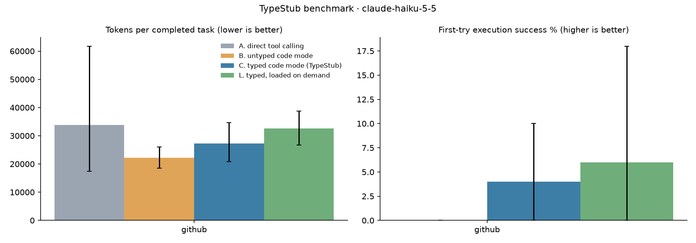

# TypeStub benchmark results: `v1-github`

200 episodes (0 dropped for API errors). Values are point estimates with 95% bootstrap CIs over tasks.
Sampling: model defaults (these models do not accept `temperature`), effort medium.

## claude-haiku-5-5

| server | condition | task success | first-try success | round trips | tokens / completed task | tokens / episode | non-submitting scripts | wall s |
|---|---|---|---|---|---|---|---|---|
| github | A | 98.0% [94.0, 100.0] | — | 2.62 [2.14, 3.32] | 33,799 [17,397, 61,777] | 33,123 [17,035, 60,374] | 0.00 [0.00, 0.00] | 8.96 [4.15, 15.93] |
| github | B | 98.0% [94.0, 100.0] | 0.0% [0.0, 0.0] | 3.30 [2.78, 3.82] | 22,236 [18,446, 26,046] | 21,791 [17,712, 25,904] | 2.02 [1.56, 2.44] | 11.68 [6.95, 18.41] |
| github | C | 98.0% [94.0, 100.0] | 4.0% [0.0, 10.0] | 3.10 [2.46, 3.76] | 27,285 [20,855, 34,647] | 26,739 [20,822, 32,652] | 1.66 [1.26, 2.06] | 13.81 [6.16, 26.01] |
| github | L | 100.0% [100.0, 100.0] | 6.0% [0.0, 18.0] | 4.02 [3.44, 4.66] | 32,635 [26,743, 38,767] | 32,635 [27,165, 38,880] | 1.64 [1.24, 2.08] | 12.89 [8.14, 17.68] |
| all | A | 98.0% [94.0, 100.0] | — | 2.62 [2.14, 3.32] | 33,799 [17,201, 62,835] | 33,123 [17,371, 61,115] | 0.00 [0.00, 0.00] | 8.96 [4.00, 16.27] |
| all | B | 98.0% [94.0, 100.0] | 0.0% [0.0, 0.0] | 3.30 [2.76, 3.80] | 22,236 [18,412, 26,191] | 21,791 [17,596, 25,704] | 2.02 [1.58, 2.42] | 11.68 [6.67, 18.27] |
| all | C | 98.0% [94.0, 100.0] | 4.0% [0.0, 10.0] | 3.10 [2.48, 3.74] | 27,285 [20,636, 34,787] | 26,739 [20,730, 32,993] | 1.66 [1.24, 2.06] | 13.81 [6.23, 25.87] |
| all | L | 100.0% [100.0, 100.0] | 6.0% [0.0, 18.0] | 4.02 [3.44, 4.64] | 32,635 [26,693, 38,488] | 32,635 [27,045, 38,639] | 1.64 [1.20, 2.08] | 12.89 [8.07, 18.00] |

**Typed (C) vs untyped (B) code mode**

| server | tokens / completed task | first-try success | task success | round trips |
|---|---|---|---|---|
| github | 22.7% [5.4, 38.5] | 4.0% [0.0, 10.0] pts | 0.0% [-6.0, 6.0] pts | -0.20 [-0.48, 0.08] |
| all | 22.7% [5.3, 38.2] | 4.0% [0.0, 10.0] pts | 0.0% [-6.0, 6.0] pts | -0.20 [-0.50, 0.08] |

**Typed on demand (L) vs untyped (B) code mode**

| server | tokens / completed task | first-try success | task success | round trips |
|---|---|---|---|---|
| github | 46.8% [18.2, 78.3] | 6.0% [0.0, 18.0] pts | 2.0% [0.0, 6.0] pts | 0.72 [0.02, 1.36] |
| all | 46.8% [17.4, 76.6] | 6.0% [0.0, 18.0] pts | 2.0% [0.0, 6.0] pts | 0.72 [0.04, 1.40] |

**Stub overhead** (system prompt tokens, counted with the token-counting API; L also pays for `types` results inside the episode)

| server | untyped (B) | typed (C) | C overhead | lazy (L) | L overhead |
|---|---|---|---|---|---|
| github | 4,585 | 6,903 | 2,318 | 5,441 | 856 |

**v0 success criteria**

| area | metric | target | measured | met |
|---|---|---|---|---|
| Cost | tokens per completed task, C vs B | ≤ -30% | 22.7% [5.3, 38.2] | no |
| Reliability | first-try execution success, C vs B | ≥ +20 pts | 4.0% [0.0, 10.0] | no |
| Speed | round trips per task (C) | ≤ 1.5 | 3.10 [2.48, 3.74] | no |
| Quality | task success, C vs B | no drop | 0.0% [-6.0, 6.0] | yes |
| Overhead | typed stub tokens (worst server) | < 1,500 | 2,318 | no |

