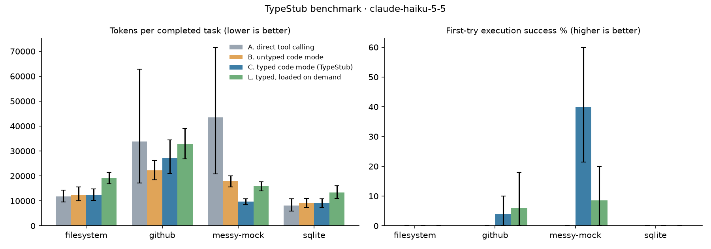

# TypeStub benchmark results: `v1-haiku`

800 episodes (0 dropped for API errors). Values are point estimates with 95% bootstrap CIs over tasks.
Billed tokens weight each episode as it is billed, in input-token equivalents: cache reads 0.1x, cache writes 1.25x, output at the output/input price ratio. Raw tokens count cache reads at full weight, which overstates the cost of a stub that sits in the cached system prompt. First fetch right: the first script ran cleanly, later scripts made no tool calls, and the answer passed (a separate submit-only turn does not count against it).
Sampling: model defaults (these models do not accept `temperature`), effort medium.

## claude-haiku-5-5

| server | condition | task success | first-try success | first fetch right | round trips | tokens / completed task | billed tokens / completed task | tokens / episode | non-submitting scripts | wall s |
|---|---|---|---|---|---|---|---|---|---|---|
| filesystem | A | 100.0% [100.0, 100.0] | — | — | 3.48 [3.17, 3.77] | 11,749 [9,528, 14,358] | 8,368 [5,286, 12,504] | 11,749 [9,530, 14,193] | 0.00 [0.00, 0.00] | 4.83 [3.67, 6.36] |
| filesystem | B | 100.0% [100.0, 100.0] | 0.0% [0.0, 0.0] | 0.0% [0.0, 0.0] | 4.25 [3.83, 4.78] | 12,473 [10,050, 15,536] | 7,749 [5,836, 9,885] | 12,473 [10,123, 15,579] | 2.75 [2.38, 3.12] | 5.35 [4.42, 6.48] |
| filesystem | C | 100.0% [100.0, 100.0] | 0.0% [0.0, 0.0] | 10.0% [0.0, 25.0] | 3.60 [3.08, 4.15] | 12,417 [10,219, 14,818] | 7,572 [6,204, 8,726] | 12,417 [10,219, 14,990] | 2.30 [1.90, 2.67] | 4.65 [3.93, 5.26] |
| filesystem | L | 100.0% [100.0, 100.0] | 0.0% [0.0, 0.0] | 0.0% [0.0, 0.0] | 4.60 [4.20, 4.95] | 19,156 [16,854, 21,482] | 9,914 [8,260, 11,730] | 19,156 [16,853, 21,440] | 2.73 [2.30, 3.20] | 6.34 [5.51, 7.04] |
| github | A | 98.0% [94.0, 100.0] | — | — | 2.62 [2.14, 3.36] | 33,799 [17,216, 62,756] | 17,743 [8,262, 31,009] | 33,123 [17,252, 60,842] | 0.00 [0.00, 0.00] | 8.96 [4.12, 16.06] |
| github | B | 98.0% [94.0, 100.0] | 0.0% [0.0, 0.0] | 28.0% [8.0, 54.0] | 3.30 [2.74, 3.84] | 22,236 [18,494, 26,150] | 10,681 [8,421, 13,415] | 21,791 [17,989, 25,569] | 2.02 [1.58, 2.42] | 11.68 [6.77, 18.47] |
| github | C | 98.0% [94.0, 100.0] | 4.0% [0.0, 10.0] | 46.0% [20.0, 72.0] | 3.10 [2.48, 3.74] | 27,285 [20,994, 34,518] | 10,152 [7,501, 12,983] | 26,739 [20,590, 32,817] | 1.66 [1.26, 2.06] | 13.81 [6.28, 25.73] |
| github | L | 100.0% [100.0, 100.0] | 6.0% [0.0, 18.0] | 52.0% [32.0, 72.0] | 4.02 [3.42, 4.66] | 32,635 [26,852, 38,997] | 13,047 [10,638, 15,263] | 32,635 [27,214, 38,595] | 1.64 [1.24, 2.08] | 12.89 [8.57, 17.68] |
| messy-mock | A | 100.0% [100.0, 100.0] | — | — | 3.20 [2.63, 3.84] | 43,492 [20,774, 71,619] | 33,259 [16,524, 55,612] | 43,492 [20,132, 70,673] | 0.00 [0.00, 0.00] | 9.63 [5.11, 16.60] |
| messy-mock | B | 100.0% [100.0, 100.0] | 0.0% [0.0, 0.0] | 0.0% [0.0, 0.0] | 4.30 [3.97, 4.63] | 17,897 [15,642, 20,080] | 11,681 [10,265, 13,012] | 17,897 [15,566, 20,047] | 2.86 [2.57, 3.13] | 7.43 [6.37, 8.46] |
| messy-mock | C | 100.0% [100.0, 100.0] | 40.0% [21.4, 60.0] | 71.4% [60.0, 82.9] | 1.79 [1.54, 2.01] | 9,732 [8,392, 10,915] | 4,957 [4,309, 5,615] | 9,732 [8,377, 10,948] | 0.79 [0.54, 1.01] | 2.80 [2.39, 3.21] |
| messy-mock | L | 100.0% [100.0, 100.0] | 8.6% [0.0, 20.0] | 52.9% [35.7, 70.0] | 3.57 [3.27, 3.90] | 15,855 [13,953, 17,725] | 8,962 [7,966, 10,068] | 15,855 [13,981, 17,656] | 1.37 [1.16, 1.59] | 5.44 [4.83, 6.07] |
| sqlite | A | 100.0% [100.0, 100.0] | — | — | 4.55 [4.25, 4.88] | 8,158 [5,934, 10,912] | 5,528 [3,831, 7,710] | 8,158 [6,055, 11,052] | 0.00 [0.00, 0.00] | 5.33 [4.60, 6.14] |
| sqlite | B | 95.0% [85.0, 100.0] | 0.0% [0.0, 0.0] | 0.0% [0.0, 0.0] | 4.25 [3.88, 4.55] | 9,128 [7,371, 11,035] | 6,524 [5,254, 7,794] | 8,672 [7,104, 10,180] | 3.27 [2.88, 3.62] | 5.77 [4.44, 7.32] |
| sqlite | C | 97.5% [92.5, 100.0] | 0.0% [0.0, 0.0] | 0.0% [0.0, 0.0] | 3.83 [3.50, 4.12] | 9,062 [7,395, 10,920] | 6,385 [5,182, 7,844] | 8,836 [7,447, 10,541] | 3.17 [2.88, 3.52] | 4.74 [4.20, 5.34] |
| sqlite | L | 100.0% [100.0, 100.0] | 0.0% [0.0, 0.0] | 0.0% [0.0, 0.0] | 4.65 [4.20, 5.12] | 13,300 [11,009, 16,069] | 7,858 [6,778, 9,155] | 13,300 [10,823, 15,989] | 3.40 [3.08, 3.77] | 5.76 [4.96, 6.63] |
| all | A | 99.5% [98.5, 100.0] | — | — | 3.38 [3.05, 3.73] | 27,623 [17,089, 40,332] | 18,861 [11,565, 28,285] | 27,484 [17,131, 40,029] | 0.00 [0.00, 0.00] | 7.64 [5.33, 10.81] |
| all | B | 98.5% [96.0, 100.0] | 0.0% [0.0, 0.0] | 7.0% [1.5, 14.5] | 4.03 [3.79, 4.29] | 16,183 [14,201, 18,181] | 9,639 [8,530, 10,781] | 15,941 [13,891, 18,018] | 2.71 [2.48, 2.92] | 7.74 [6.34, 9.63] |
| all | C | 99.0% [97.5, 100.0] | 15.0% [7.0, 24.0] | 38.5% [27.0, 50.5] | 2.88 [2.54, 3.21] | 14,487 [11,842, 17,530] | 7,052 [6,079, 8,112] | 14,342 [11,534, 17,283] | 1.78 [1.47, 2.11] | 6.31 [4.20, 9.88] |
| all | L | 100.0% [100.0, 100.0] | 4.5% [0.5, 9.0] | 31.5% [20.5, 43.5] | 4.11 [3.85, 4.38] | 20,199 [17,333, 23,100] | 9,953 [8,984, 10,936] | 20,199 [17,381, 23,423] | 2.12 [1.81, 2.43] | 7.55 [6.10, 9.28] |

**Typed (C) vs untyped (B) code mode**

| server | tokens / completed task | billed tokens / completed task | first-try success | first fetch right | task success | round trips |
|---|---|---|---|---|---|---|
| filesystem | -0.4% [-23.4, 26.1] | -2.3% [-17.7, 16.5] | 0.0% [0.0, 0.0] pts | 10.0% [0.0, 25.0] pts | 0.0% [0.0, 0.0] pts | -0.65 [-1.38, -0.03] |
| github | 22.7% [5.3, 38.2] | -5.0% [-15.4, 4.4] | 4.0% [0.0, 8.0] pts | 18.0% [-0.0, 40.0] pts | 0.0% [-6.0, 6.0] pts | -0.20 [-0.50, 0.08] |
| messy-mock | -45.6% [-52.8, -38.5] | -57.6% [-63.2, -51.0] | 40.0% [21.4, 58.6] pts | 71.4% [60.0, 82.9] pts | 0.0% [0.0, 0.0] pts | -2.51 [-2.79, -2.24] |
| sqlite | -0.7% [-12.7, 12.9] | -2.1% [-12.1, 9.7] | 0.0% [0.0, 0.0] pts | 0.0% [0.0, 0.0] pts | 2.5% [0.0, 7.5] pts | -0.42 [-0.88, 0.02] |
| all | -10.5% [-22.9, 2.5] | -26.8% [-36.8, -16.8] | 15.0% [7.0, 24.0] pts | 31.5% [20.0, 43.5] pts | 0.5% [-1.0, 2.0] pts | -1.15 [-1.50, -0.77] |

**Typed on demand (L) vs untyped (B) code mode**

| server | tokens / completed task | billed tokens / completed task | first-try success | first fetch right | task success | round trips |
|---|---|---|---|---|---|---|
| filesystem | 53.6% [20.8, 84.8] | 27.9% [8.1, 50.9] | 0.0% [0.0, 0.0] pts | 0.0% [0.0, 0.0] pts | 0.0% [0.0, 0.0] pts | 0.35 [-0.40, 0.93] |
| github | 46.8% [18.2, 80.1] | 22.2% [-4.7, 50.5] | 6.0% [0.0, 18.0] pts | 24.0% [0.0, 46.0] pts | 2.0% [0.0, 6.0] pts | 0.72 [0.06, 1.40] |
| messy-mock | -11.4% [-22.7, 1.9] | -23.3% [-34.3, -9.0] | 8.6% [0.0, 18.6] pts | 52.9% [35.7, 70.0] pts | 0.0% [0.0, 0.0] pts | -0.73 [-1.03, -0.39] |
| sqlite | 45.7% [23.6, 65.8] | 20.5% [5.2, 34.9] | 0.0% [0.0, 0.0] pts | 0.0% [0.0, 0.0] pts | 5.0% [0.0, 15.0] pts | 0.40 [0.10, 0.78] |
| all | 24.8% [9.3, 41.2] | 3.3% [-9.0, 16.5] | 4.5% [0.5, 10.0] pts | 24.5% [14.5, 35.5] pts | 1.5% [0.0, 4.0] pts | 0.08 [-0.23, 0.40] |

**Stub overhead** (system prompt tokens, counted with the token-counting API; L also pays for `types` results inside the episode)

| server | untyped (B) | typed (C) | C overhead | lazy (L) | L overhead |
|---|---|---|---|---|---|
| filesystem | 1,402 | 1,908 | 506 | 2,085 | 683 |
| github | 4,585 | 6,903 | 2,318 | 5,441 | 856 |
| messy-mock | 1,585 | 4,513 | 2,928 | 2,104 | 519 |
| sqlite | 586 | 792 | 206 | 763 | 177 |

**v0 success criteria**

| area | metric | target | measured | met |
|---|---|---|---|---|
| Cost | tokens per completed task, C vs B | ≤ -30% | -10.5% [-22.9, 2.5] | no |
| Cost (billed) | billed tokens per completed task, C vs B | ≤ -30% | -26.8% [-36.8, -16.8] | no |
| Reliability | first-try execution success, C vs B | ≥ +20 pts | 15.0% [7.0, 24.0] | no |
| Speed | round trips per task (C) | ≤ 1.5 | 2.88 [2.54, 3.21] | no |
| Quality | task success, C vs B | no drop | 0.5% [-1.0, 2.0] | yes |
| Overhead | typed stub tokens (worst server) | < 1,500 | 2,928 | no |

