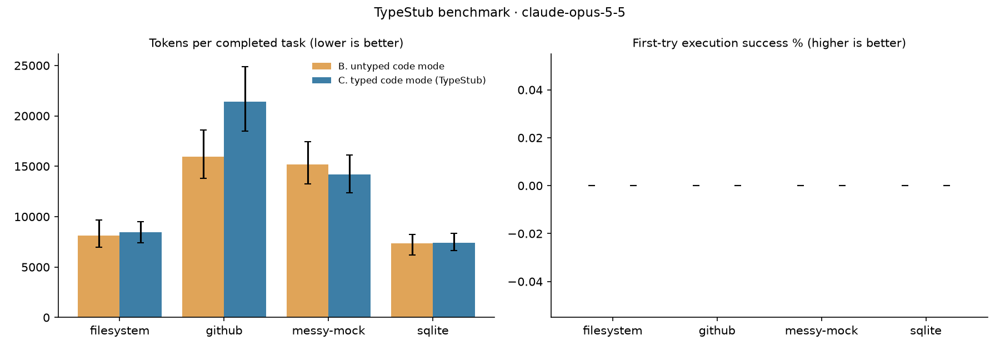

# TypeStub benchmark results: `v1-opus`

378 episodes (0 dropped for API errors). Values are point estimates with 95% bootstrap CIs over tasks.
Billed tokens weight each episode as it is billed, in input-token equivalents: cache reads 0.1x, cache writes 1.25x, output at the output/input price ratio. Raw tokens count cache reads at full weight, which overstates the cost of a stub that sits in the cached system prompt. First fetch right: the first script ran cleanly, later scripts made no tool calls, and the answer passed (a separate submit-only turn does not count against it).
Sampling: model defaults (these models do not accept `temperature`), effort medium.

## claude-opus-5-5

| server | condition | task success | first-try success | first fetch right | round trips | tokens / completed task | billed tokens / completed task | tokens / episode | non-submitting scripts | wall s |
|---|---|---|---|---|---|---|---|---|---|---|
| filesystem | B | 100.0% [100.0, 100.0] | 0.0% [0.0, 0.0] | 2.5% [0.0, 7.5] | 3.17 [2.88, 3.50] | 8,151 [6,971, 9,651] | 4,830 [3,928, 5,845] | 8,151 [6,972, 9,501] | 1.82 [1.60, 2.05] | 7.03 [5.81, 8.37] |
| filesystem | C | 100.0% [100.0, 100.0] | 0.0% [0.0, 0.0] | 22.5% [5.0, 42.5] | 2.90 [2.55, 3.25] | 8,438 [7,394, 9,487] | 4,761 [4,307, 5,191] | 8,438 [7,394, 9,440] | 1.65 [1.40, 1.88] | 7.07 [6.21, 8.05] |
| github | B | 100.0% [100.0, 100.0] | 0.0% [0.0, 0.0] | 72.0% [50.0, 90.0] | 2.72 [2.42, 3.08] | 15,928 [13,776, 18,574] | 5,887 [5,181, 6,607] | 15,928 [13,690, 18,742] | 1.28 [1.10, 1.50] | 9.71 [7.47, 12.23] |
| github | C | 100.0% [100.0, 100.0] | 0.0% [0.0, 0.0] | 70.0% [46.0, 92.0] | 2.70 [2.38, 3.12] | 21,400 [18,493, 24,909] | 6,353 [5,549, 7,262] | 21,400 [18,476, 24,802] | 1.30 [1.08, 1.54] | 9.75 [7.01, 12.78] |
| messy-mock | B | 100.0% [100.0, 100.0] | 0.0% [0.0, 0.0] | 0.0% [0.0, 0.0] | 3.87 [3.57, 4.19] | 15,206 [13,230, 17,443] | 8,741 [7,621, 9,834] | 15,206 [13,232, 17,399] | 2.79 [2.50, 3.13] | 11.26 [9.65, 12.99] |
| messy-mock | C | 100.0% [100.0, 100.0] | 0.0% [0.0, 0.0] | 47.8% [25.7, 69.7] | 2.58 [2.28, 2.90] | 14,198 [12,359, 16,131] | 5,652 [4,822, 6,477] | 14,198 [12,291, 16,208] | 1.45 [1.23, 1.67] | 6.71 [5.77, 7.67] |
| sqlite | B | 100.0% [100.0, 100.0] | 0.0% [0.0, 0.0] | 0.0% [0.0, 0.0] | 3.75 [3.50, 3.94] | 7,330 [6,195, 8,233] | 5,018 [4,139, 5,917] | 7,330 [6,264, 8,255] | 2.34 [2.12, 2.62] | 9.69 [7.69, 11.69] |
| sqlite | C | 100.0% [100.0, 100.0] | 0.0% [0.0, 0.0] | 0.0% [0.0, 0.0] | 3.41 [3.16, 3.69] | 7,406 [6,642, 8,373] | 4,788 [4,014, 5,701] | 7,406 [6,622, 8,422] | 2.34 [2.09, 2.59] | 8.16 [6.14, 11.09] |
| all | B | 100.0% [100.0, 100.0] | 0.0% [0.0, 0.0] | 19.6% [9.1, 31.3] | 3.40 [3.17, 3.60] | 12,570 [11,064, 14,210] | 6,528 [5,792, 7,236] | 12,570 [10,955, 14,284] | 2.11 [1.87, 2.36] | 9.69 [8.66, 10.82] |
| all | C | 100.0% [100.0, 100.0] | 0.0% [0.0, 0.0] | 40.2% [27.1, 53.6] | 2.82 [2.63, 3.01] | 13,734 [11,726, 15,775] | 5,503 [5,049, 5,999] | 13,734 [11,822, 15,786] | 1.60 [1.44, 1.76] | 7.83 [6.82, 8.95] |

**Typed (C) vs untyped (B) code mode**

| server | tokens / completed task | billed tokens / completed task | first-try success | first fetch right | task success | round trips |
|---|---|---|---|---|---|---|
| filesystem | 3.5% [-13.6, 22.9] | -1.4% [-15.2, 15.8] | 0.0% [0.0, 0.0] pts | 20.0% [5.0, 40.0] pts | 0.0% [0.0, 0.0] pts | -0.27 [-0.73, 0.17] |
| github | 34.4% [3.3, 69.5] | 7.9% [-7.9, 27.0] | 0.0% [0.0, 0.0] pts | -2.0% [-38.0, 32.0] pts | 0.0% [0.0, 0.0] pts | -0.02 [-0.64, 0.50] |
| messy-mock | -6.6% [-22.4, 12.1] | -35.3% [-44.8, -23.5] | 0.0% [0.0, 0.0] pts | 47.8% [24.6, 72.3] pts | 0.0% [0.0, 0.0] pts | -1.28 [-1.70, -0.87] |
| sqlite | 1.0% [-9.4, 16.6] | -4.6% [-17.9, 11.6] | 0.0% [0.0, 0.0] pts | 0.0% [0.0, 0.0] pts | 0.0% [0.0, 0.0] pts | -0.34 [-0.72, 0.06] |
| all | 9.3% [-4.7, 25.4] | -15.7% [-24.9, -5.4] | 0.0% [0.0, 0.0] pts | 20.6% [6.3, 34.8] pts | 0.0% [0.0, 0.0] pts | -0.58 [-0.87, -0.29] |

**Stub overhead** (system prompt tokens, counted with the token-counting API; L also pays for `types` results inside the episode)

| server | untyped (B) | typed (C) | C overhead | lazy (L) | L overhead |
|---|---|---|---|---|---|
| filesystem | 1,402 | 1,908 | 506 | 2,085 | 683 |
| github | 4,585 | 6,903 | 2,318 | 5,441 | 856 |
| messy-mock | 1,585 | 4,513 | 2,928 | 2,104 | 519 |
| sqlite | 586 | 792 | 206 | 763 | 177 |

**v0 success criteria**

| area | metric | target | measured | met |
|---|---|---|---|---|
| Cost | tokens per completed task, C vs B | ≤ -30% | 9.3% [-4.7, 25.4] | no |
| Cost (billed) | billed tokens per completed task, C vs B | ≤ -30% | -15.7% [-24.9, -5.4] | no |
| Reliability | first-try execution success, C vs B | ≥ +20 pts | 0.0% [0.0, 0.0] | no |
| Speed | round trips per task (C) | ≤ 1.5 | 2.82 [2.63, 3.01] | no |
| Quality | task success, C vs B | no drop | 0.0% [0.0, 0.0] | yes |
| Overhead | typed stub tokens (worst server) | < 1,500 | 2,928 | no |

